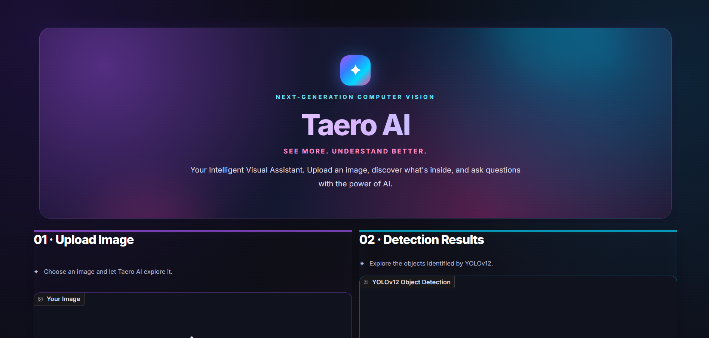
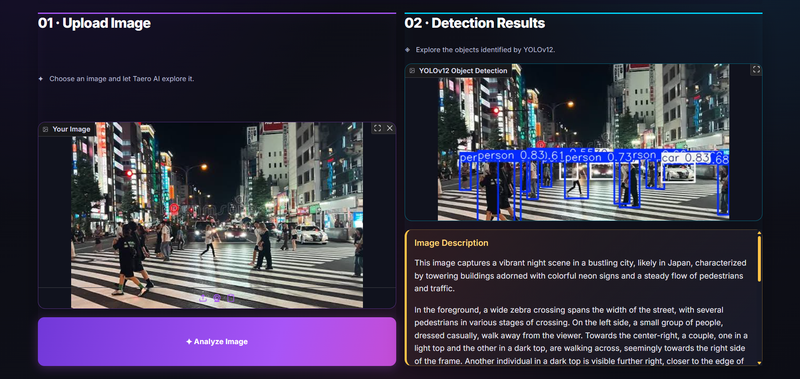
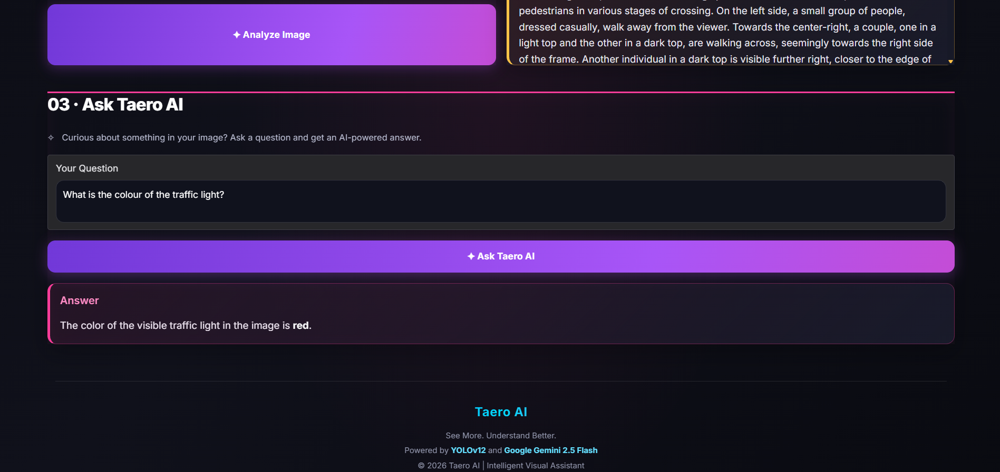

<div align="center">

# 🚀 Taero AI

### ✨ See More. Understand Better.

**Your Intelligent Visual Assistant**

🧠 NEXT-GENERATION COMPUTER VISION

🔍 Detect · 📝 Describe · 💬 Discover

</div>

---

## 🌟 What is Taero AI?

Ever wondered what an image could tell you beyond what meets the eye?

**Taero AI** is an AI-powered Conversational Image Recognition Chatbot that brings computer vision and generative AI together to make image understanding smarter, easier, and more interactive.

Powered by **YOLOv12** and **Google Gemini**, Taero AI doesn't just detect objects — it helps you understand the bigger picture through intelligent descriptions and natural-language conversations.

Upload an image, explore what's inside, and simply ask away! 🚀

## ✨ Key Features

| Feature | What it does |
|---|---|
| 🎯 **Smart Object Detection** | Identifies objects in images using YOLOv12 with bounding boxes and labels. |
| 🖼️ **AI Image Captioning** | Generates meaningful image descriptions using Google Gemini. |
| 💬 **Visual Question Answering** | Ask questions about an image and receive contextual AI-generated answers. |
| ⚡ **Interactive Experience** | Explore image analysis through a simple Gradio-powered interface. |
| 🧠 **Intelligent Integration** | Combines computer vision and generative AI in one application. |

## 🛠️ Tech Stack

| Technology | Role |
|---|---|
| 🐍 Python 3.12 | Core programming language |
| 🎯 YOLOv12 | Object detection |
| ⚙️ Ultralytics | YOLO framework |
| ✨ Google Gemini | Image captioning and visual question answering |
| 🎨 Gradio | Interactive web interface |
| 🔢 NumPy | Numerical operations |
| 👁️ OpenCV | Image processing |
| 🖼️ Pillow | Image handling |

## 🔄 How Does It Work?

Here's how Taero AI transforms an ordinary image into an interactive experience:

1. 📤 **Upload an Image** — Select an image through the application.
2. 🎯 **Detect Objects** — YOLOv12 identifies objects and draws bounding boxes.
3. 📝 **Generate a Description** — Gemini interprets the image and generates a natural-language caption.
4. ❓ **Ask a Question** — Type any question related to the uploaded image.
5. 💡 **Get Intelligent Answers** — Gemini analyzes the image and question to provide a response.

**Upload. Detect. Understand. Explore.** ✨


## 📸 See Taero AI in Action

### 🏠 Taero AI Homepage


### 🎯 Object Detection & Image Description


### 💬 Visual Question Answering



## 🚀 Getting Started

Want to run Taero AI on your own machine? Let's get started!

### 📋 Prerequisites

Before installing, make sure you have:

- 🐍 Python 3.12
- 📦 pip
- 🔑 A Google Gemini API key
- 🧑‍💻 Git

### 1️⃣ Clone the Repository

```bash
git clone https://github.com/Tanavi10/Conversational-Image-Recognition-Chatbot-.git
cd Conversational-Image-Recognition-Chatbot-
```

### 2️⃣ Install Dependencies

```bash
python -m pip install -r requirements.txt
```

### 3️⃣ Set Up Your Gemini API Key 🔐

Get your API key from [Google AI Studio](https://aistudio.google.com/apikey).

The application supports the `GEMINI_API_KEY` environment variable and a local key file:

```text
utils/gemini_api_key.txt
```

Keep your API key private! Never commit it to GitHub.

For deployment, configure the key through your hosting provider's environment variables or secrets.

### 4️⃣ Launch Taero AI 🎉

Run:

```bash
python chatbot_app.py
```

Open the local URL displayed in your terminal and start exploring!

## 📦 Requirements

The Python dependencies are maintained in [`requirements.txt`](requirements.txt).

| Package | Version |
|---|---|
| Gradio | 5.24.0 |
| Ultralytics | 8.3.105 |
| Google Generative AI | 0.8.5 |
| NumPy | 2.1.1 |
| Pillow | 10.3.0 |
| OpenCV | 4.11.0.86 |

📌 **Note:** The YOLO model weights (`yolo12s.pt`) must be available at the path expected by the application.

## 📚 Research Publication

Taero AI is associated with the following research publication:

📄 **Conversational Image Recognition Chatbot using YOLOv12**

- **Conference:** ICSFT 2026
- **Authors:** Jagruti D. Waje, Tanavi Gaikwad, Sunita Barve, Diptee Chikmurge
- **DOI:** [10.1109/ICSFT66733.2026.11506770](https://doi.org/10.1109/ICSFT66733.2026.11506770)

## 🗂️ Project Structure

```text
Taero_AI/
│
├── chatbot_app.py          # Main Gradio application
├── requirements.txt        # Python dependencies
├── yolo12s.pt              # YOLO model weights
│
├── utils/
│   ├── gemini_captioning.py
│   ├── gemini_vqa.py
│   ├── yolo_detection.py
│   └── api_key_loader.py
│
├── examples/               # Example images
├── datasets/               # Dataset resources
└── README.md
```

*This is a simplified overview of the main project files.*

## 🔮 Future Possibilities

What's next for Taero AI?

- 🚀 Improved detection accuracy and performance
- 🧠 More advanced visual understanding
- 💬 Better conversational context and follow-up questions
- 🌐 Wider accessibility through cloud deployment
- ✨ An even smarter visual assistant experience

## 🙌 Acknowledgements

A big thank you to the teams behind the technologies that make this project possible:

- [Ultralytics](https://github.com/ultralytics/ultralytics) — YOLO framework
- [Google AI](https://ai.google.dev/) — Gemini models
- [Gradio](https://www.gradio.app/) — Interactive interface

---

<div align="center">

### 💜 Taero AI

**See More. Understand Better.**

🔍 Detect · 📝 Describe · 💬 Discover

*Making image understanding more intelligent, one picture at a time.*

</div>
